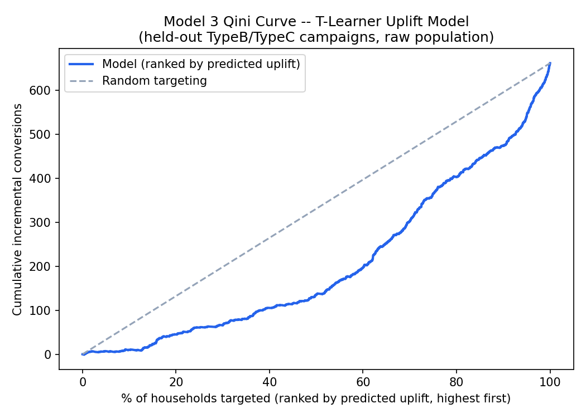
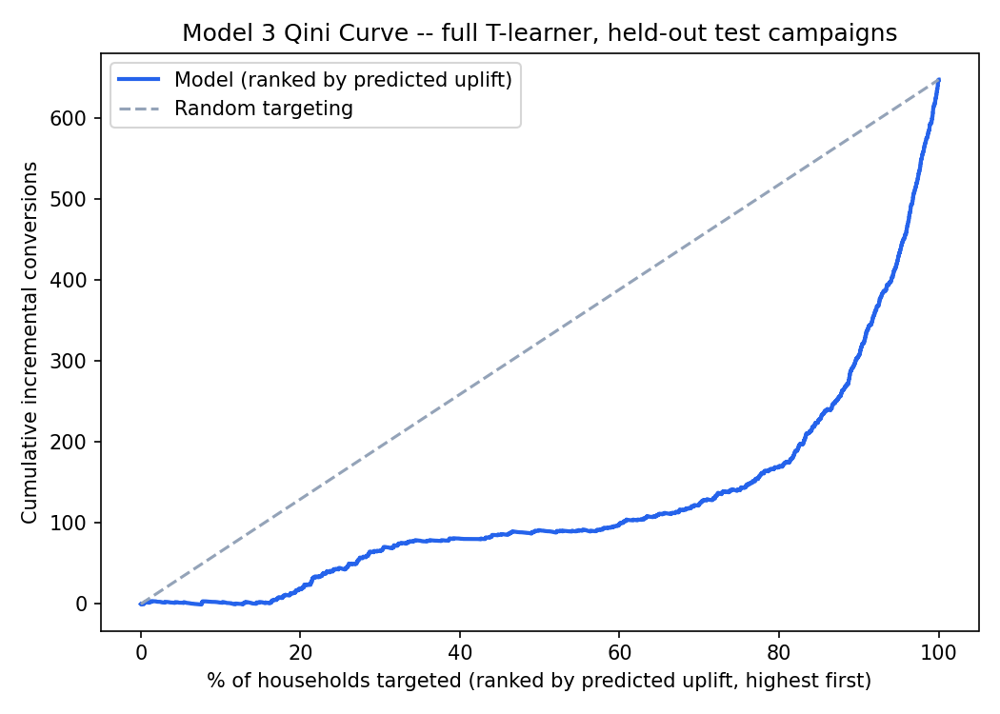

# Midterm Report: DSI Capstone

Yuxin Cai, Pranav Jain, Shreya Shetty, John Won, Zhiyan Yang

---

## 1. Introduction

### 1.1 Motivation and Business Problem

Marketing organizations increasingly rely on predictive models to decide which customers should
receive a campaign, whether that is a marketing email, a promotion or a coupon. The people involved
in that decision usually sit in two separate roles: data scientists, who build and maintain the
models, and marketers, who plan the campaigns and decide who to target, what to offer and how much
to spend.

The difficulty is that these two roles do not easily connect. A marketer planning a campaign wants
to know which customers to target, what would happen if the offer or the budget changed, and why
the model favors one segment over another, but a model's outputs do not answer these questions
directly and are often hard for business users to interpret. Since marketers cannot work with the
models themselves, each new question has to go back through a data scientist.

Data scientists, on the other hand, face a problem of their own, because developing a model
involves multiple steps, from preparing the data and building features to training and comparing
models, and this work has to be repeated every time new data arrives or a campaign finishes. Each
of those steps involves judgment calls that are easy to lose track of, especially when the person
maintaining a model is not the person who originally built it.

This project, sponsored by TD Bank, builds an Agentic AI Marketing Decision Lab to close this gap
by supporting both roles, with an AI agent designed for each one. The data scientist works with a
Data Scientist Agent, a co-engineer that keeps the models up to date as new data arrives, explains
what changed and why, proposes what to try next, and flags anomalies when it finds something new.
The marketer, in turn, works with a Decision Support Agent inside an interactive application, where
they can explore campaign options and ask questions without needing to understand the models
underneath. Since both agents sit on top of the same models, the answers a marketer receives come
from work that a data scientist has already reviewed.

### 1.2 Existing Work

Direct marketing research has long used past behavior to predict who will respond to a campaign
and to weigh that response against the cost of each mailing ([Bult & Wansbeek, 1995](https://doi.org/10.1287/mksc.14.4.378);
[Fader, Hardie & Lee, 2005](https://doi.org/10.1509/jmkr.2005.42.4.415)), and uplift modeling goes
one step further by estimating the change in behavior that a campaign causes, which response models
are not designed to measure ([Radcliffe & Surry, 2011](https://stochasticsolutions.com/pdf/sig-based-up-trees.pdf);
[Künzel et al., 2019](https://doi.org/10.1073/pnas.1804597116)). More recently, AI agents built on
large language models have been used to automate data analysis tasks ([Guo et al., 2024](https://proceedings.mlr.press/v235/guo24b.html);
[Hong et al., 2025](https://aclanthology.org/2025.findings-acl.1016/)). Our project brings these
three areas together in one system, which is built around the two people who have to use it.

### 1.3 Problem Statement

Our goal is to show how AI can support the full analytics lifecycle, from data preparation and
predictive modeling to decision support through an interactive application. We test this system on
the public dunnhumby "The Complete Journey" dataset using three predictive models, which together
tell a marketer who is likely to respond to a campaign, what that response is worth, and whether
the campaign changed what a household bought:

* **Response model (Model 1):** Predicts the probability that a mailed household redeems at least
  one coupon from a campaign.
* **Value model (Model 2):** Predicts how much a household that redeems will spend on the
  campaign's products during the campaign.
* **Uplift model (Model 3):** Estimates how much more likely a household is to buy the campaign's
  products because it was mailed.

The project seeks to answer research questions in three areas:

* **Model development:** Can specialized AI agents improve the efficiency and quality of predictive
  model development?
* **Prediction:** How accurately can campaign response be predicted from historical retail and
  marketing data, and which customer and campaign characteristics are most predictive?
* **Decision support:** Can a generative AI-based Decision Support Agent improve interpretation of
  model outputs, and does an AI-assisted platform improve business users' ability to evaluate
  alternative marketing strategies?

### 1.4 Overview

We are building an end-to-end system that takes raw retail data and turns it into campaign
decisions that a marketer can act on. On the data science side, separate agents clean the data,
build the features, and train and evaluate the response, value and uplift models, and a data
scientist runs and maintains all of this by working with a single Data Scientist Agent that acts
as an interface between the scientist and all the underlying agents. On the marketing side, the
results feed into the Decision Lab, an application where a marketer can explore campaign options
and ask a Decision Support Agent questions in plain language. The result is one system in which a
data scientist can keep the models up to date and a marketer can use their results directly,
without every question having to pass between the two.

---

## 2. Methods

### 2.1 Data

#### 2.1.1 Dataset and pipeline-wide preprocessing

All three models start from the dunnhumby "The Complete Journey" dataset, which follows 2,500
households at one retailer for two years. It has a transaction table, product and
household-demographic tables, and the campaign, coupon, coupon-redemption and in-store promotion
tables that link campaigns to purchases. The Data Agent sits first in the pipeline and produces the
cleaned, linked inputs that Feature Agent 2A reads. Its job is to clean, validate, link and flag,
and it does not build any household-level features. Aggregating household behavior is left to the
Feature Agent, so that nothing the Data Agent does can leak a model's outcome into its inputs.

The agent follows a "flag, don't delete" rule. Raw retail data contains problems that are sometimes
errors and sometimes real behavior, such as returns, free items and very large baskets, so every
row is kept and marked, and the only rows removed are exact duplicate coupon records. A discount or
quantity that looks like a sign typo is flagged, and a corrected value goes into a new column only
if it can be checked against that product's normal behavior; the original value is never changed. A
missing quantity likewise gets an imputed value in a separate column. Extreme values are flagged
using log-scale outlier fences, and the 29,637 fuel and miscellaneous rows (1.14% of transactions)
are separated from merchandise and flagged, with an option to exclude them from spend features.

Every decision is written to a log that records the rule, the number of rows affected, the action
taken, and whether a rule or a person made the call. The current log has 19 entries, and the agent
escalates three things it cannot settle from the data. Two are data conflicts: in-store promotion
records that disagree for the same product, store and week, and 24 rows that record money but no
items bought at an unusual amount. The third is a judgment call, whether fuel and miscellaneous
spend should count as household spend, which changes every spend-based feature and so belongs to
the team. The full log and the evidence behind the typo rules are in Appendix F.

**Feature Agent 2B (Shreya), shared across all three models.** Feature Agent 2A builds one shared
table (75,000 rows: 2,500 households by 30 campaigns) carrying every model's candidate input
columns and every model's answer column side by side. 2B's job is to turn that into one clean
table *per model*, the right rows and the right answer column, nothing else changed, with the
exact rule for each model read directly from `src/features/feature_2b_spec.yaml` so the design doc
and the code can't drift apart. Row counts, verified against the real data rather than assumed:
**Model 1**, every mailed household by campaign pair, all 30 campaigns, 7,208 rows; **Model 2**,
redeemed, mailed, TypeB/C only, 254 rows; **Model 3**, TypeB/C only, treatment plus clean control
(rows mailed an overlapping campaign excluded), 43,396 rows (3,229 treated, 40,167 control). 2B
also owns a **leakage rail**: each model's table only ever contains that model's own label (plus,
for Model 3, the treatment flag that decides which rows train Model T versus Model C, which is
never fed in as a model input), with every other model's outcome/filter columns dropped entirely,
not just tagged; the build script stops the run if a label column is ever found inside a feature
list. Re-running on the same 2A output reproduces byte-identical tables. More detail in Appendix D.

#### 2.1.2 Model 1 data (Campaign Response Probability)

Model 1 uses every mailed household by campaign pair across all 30 campaigns (5 Type A, 19 Type B,
6 Type C): 7,208 rows covering 1,584 households, of which 889 (12.3%) redeemed at least one of that
campaign's coupons during the campaign. Unlike Models 2 and 3, Type A stays in scope. Every feature
uses only purchases made before a cutoff seven days before the campaign starts, and Feature Agent
2A's leak test passes for every column. Features fall into five groups, mostly measured over the 26
weeks before the cutoff:

* **coupon use:** coupon lines per week, share of trips with a coupon, number of product categories
  bought with a coupon, and long-run coupon use
* **redemption history:** past redemption rate and counts
* **shopping habits:** spend, trips, basket value, departments shopped
* **fit with the campaign's products:** spend on the campaign's products
* **campaign context:** type, length, weeks of history

The baseline uses 11 columns. This work added 18 columns to Feature Agent 2A, bringing the
candidate set to 39: more detailed coupon habits, coupon use on the campaign's own products and
categories, more detailed redemption history, and demographic codes (0 = no record).

#### 2.1.3 Model 2 data (Expected Financial Value)

Model 2 is scoped to the 254 household-by-campaign pairs in which a mailed household redeemed at
least one coupon in a TypeB or TypeC campaign (161 households, 25 campaigns). The answer column is
`campaign_product_spend_during`: the household's total `SALES_VALUE` on the campaign's coupon
products from the campaign's start day to its end day, whether or not a coupon was used on each
purchase. `SALES_VALUE` is used directly, because the retailer's coupon-match discount is already
reflected in it; subtracting the discount again, as the original proposal did, would double-count
it.

TypeA campaigns are excluded for the same reason as in Model 3: each TypeA household receives 16
coupons that are not recorded, so which products count for that household is unknown. Every input
column is measured before the campaign's cutoff (start day minus 7) and passes the Feature Agent's
leak test. The key input is usual spend: the household's weekly spend on the campaign's products
over the 26 weeks before the cutoff, multiplied by the campaign's length in weeks. The other
candidate columns, tested in Section 2.3.3, cover past coupon redemptions, campaign details (type,
length, overlapping campaigns), how well the offer fits the household's past purchases,
demographics and promotion exposure.

#### 2.1.4 Model 3 data (True Incremental Uplift)

Model 3 is scoped to TypeB/TypeC campaigns: 25 of the dataset's 30 campaigns, 3,229 treated
(mailed) rows against 40,167 control rows, with no subsampling at any stage. TypeA campaigns were
excluded in an earlier scoping decision: TypeA households receive only 16 untracked coupons out of
a pool of 17,000 to 35,000 products, and treating that whole pool as "eligible" produced a 96%
false-positive conversion rate in trial testing, effectively measuring "did this household shop at
all" rather than campaign response.

Treatment and control are defined against `campaign_table`/`campaign_desc`: a household counts as
control only if it was mailed *no* campaign whose window overlaps the one being evaluated, since
campaigns overlap heavily in this data. The outcome is binary: did the household buy an eligible
product during the campaign window, excluding purchases that coincided with an in-store display or
flyer feature for that product (the `causal_data` confounder filter), so the main label isolates
direct-mail effect from in-store promotion as cleanly as the raw data allows.

A second confounder feature, `campaign_promo_share`, was added and then revised mid-effort: it
originally measured whether an eligible product was promoted *anywhere*, which was nearly constant
(21 of 25 campaigns scored a flat 1.0) and carried almost no signal. It now measures promotion at
the *household's own usual store* (the store each household shopped at most before the campaign
started), which moved it from 25 distinct values (std 0.093) to 1,240 distinct values (std 0.289), a
real increase in the information a model can use, not a cosmetic fix.

### 2.2 Exploratory Data Analysis

#### 2.2.1 Model 1

Three patterns shaped Model 1's choices:

* **Campaign type shifts the base rate.** Type A campaigns hold 55% of rows and redeem at 16.0%,
  about twice Type B (7.9%) and Type C (7.7%). They are also far larger: a median of 1,076
  households mailed, against 166 for Type B and 41 for Type C. A list pooled across campaigns would
  put Type A households on top for their campaign type alone, so Model 1 ranks, and is evaluated,
  within each campaign.
* **Coupon use is the strongest signal, and it is very skewed.** The quarter of rows with no
  coupon use in the prior 26 weeks redeems at 2.7%. The top fifth by coupon use redeems at 33.1%
  and holds 54% of all redeemers. Weekly coupon lines have a median of 0.12 and a maximum of 8.4
  (skewness 4.4). This made coupon use the bar any new feature had to beat, and it is why inputs
  are log-scaled for linear models.
* **Past redemption alone misses half of redeemers.** 50.4% of redeemers had never redeemed before,
  and 28.5% of rows are a household's first mailing. That makes the "redeemed before" rule a
  natural but weak benchmark.

Demographic records cover 58% of rows, and those households redeem at 16.1%, against 7.0% without
one. So a has-a-record flag is a feature, and the labels themselves were tested separately.

#### 2.2.2 Model 2

Three patterns in the data shaped Model 2.

* **Spend is small and right-skewed.** The median household spends $12.73 on the campaign's
  products, but the mean is $18.42, pulled up by a few large spenders. A model aimed at the typical
  household therefore under-predicts the total, and the total is what the Decision Lab needs, so we
  track both average error and whether predictions add up to actual spend (Section 3.1.2).
* **Usual spend is the strongest signal, but redeemers spend more than usual.** Ranking households
  by usual spend orders their actual spend well (rank correlation 0.54), but usual spend adds up to
  only 61% of what households actually spend during a campaign they redeem. The gap is largest for
  light buyers: households in the lowest fifth have a usual spend of about $2 but actually spend
  about $11. A model should therefore scale usual spend up rather than use it as it is.
* **Later campaigns spend more than earlier ones**, so any model trained on earlier campaigns tends
  to under-predict later ones. This is why every evaluation predicts each campaign only from
  campaigns that started before it. With 254 rows, each test also has only 60 to 220 training rows,
  which leaves little room for many columns.

#### 2.2.3 Model 3

Three questions were answered directly against the full dataset before any model was trusted:

1. **Does mailing add lift at all?** Naive treated-vs-control comparison: 49.4% vs. 13.8% purchase
   rate (z = 52.5, p approximately 0); not noise, but this raw gap mixes real campaign effect with
   the fact that heavier spenders were targeted to begin with.
2. **Does lift vary by household spend?** Bucketing households into thirds using cutoffs from the
   *treated group's own* spend distribution (population-wide cutoffs were tried first and
   rejected, since they put roughly 95% of treated households in a single bucket) shows uplift
   falling monotonically as historical spend rises: roughly 26% for low-spend households, 14% for
   medium, 9% for the heaviest spenders. The trained model reproduces the same ordering on
   held-out test campaigns (0.102 / 0.049 / 0.006).
3. **How much of "success" is actually coupon-driven?** Of 1,596 treated households who bought an
   eligible product, 1,407 (88.2%) did so *without ever redeeming the coupon*, direct, observed
   confirmation of (2), not an inference. A campaign-level breakdown (Table 7, Appendix B) shows
   this holds across every campaign with enough volume to check (79.7% to 95.2% unredeemed-but-
   bought).

A secondary demographic cut (homeowner status, number of kids, age group; full tables in Appendix A)
was also run, but only covers 801 of 2,500 households with a demographic record on file. Uplift is
positive and broadly similar across every demographic category (19 to 42 percentage points), with
no split nearly as sharp as the spend-tier one: informative by itself, since pre-campaign spend
behavior predicts responsiveness far better than who a household is demographically.

### 2.3 Analytic / Modeling Methods

#### 2.3.1 Agent architecture (Data, Feature, Modeling, Evaluation, Lead Agents)

To coordinate the Data, Feature, Modeling and Evaluation Agents, we built a lead agent, which we
call the Data Scientist Agent. A data scientist asks it for what they need, for example to bring
Model 2 up to date with the latest data, and it runs the four agents in order, from cleaning the
data and building the features to training and evaluating the models, and then returns one
plain-language summary of the results. Steps whose input data has not changed since the last run
are skipped, and the models are retrained only when a campaign finishes, since that is when we
learn which households redeemed their coupons. If the new data contains something the agent has not
seen before, such as a new product department, it stops and asks the data scientist how to handle
it, and a retrained model replaces the current one only if it passes the Evaluation Agent. Because
our dataset is fixed, we test this by replaying the data as of earlier days.

All three models are trained by the Modeling Agent and judged by the Evaluation Agent under the
same rules, so that their results can be compared. For each model, the Modeling Agent trains the
version currently in use alongside a set of alternatives, each of which changes only one thing,
such as the columns, the type of model or its settings, so that any gain can be traced back to that
change. Every alternative, whether a team member suggested it or the Data Scientist Agent proposed
it from the measured results and a person approved it, is added to the same list before it is
tested. The Evaluation Agent then trains each option on earlier campaigns and tests it on later
campaigns it has never seen, which is how the models will be used in practice, and compares it with
simple benchmarks such as choosing households at random. It then approves the model, sends it back
for changes to the model or the features, or asks a person to decide. Because testing many ideas on
the same campaigns will eventually make one look better by luck, we also hold back a few campaigns
and read them only once a choice looks settled (Dwork et al., 2015).

#### 2.3.2 Model 1

**Baseline.** The baseline (PR #8) is a random forest (300 trees, depth 6) on 11 columns. Its first
test used one 70/30 time split that ranked all campaigns together and held only one Type A test
campaign. So we re-tested it with forward chaining: each test campaign is scored by a model trained
only on campaigns that ended before its cutoff. The forest relied almost entirely on coupon use.
Shuffling that column cost 25 points of capture, and coupon use alone matched the full model.

**Candidates.** We made one change at a time, so every gain traces to the features, the learner or
both. All candidates run through the shared Modeling and Evaluation Agents (Section 2.3.1).

* Feature groups: coupon use alone, and coupon use plus one other group.
* A feature screen: 38 candidate columns on the open campaigns. The 18 that added signal became
  Feature Agent 2A columns.
* Log-scaled logistic regression: inputs become `sign(x)·log(1+|x|)`, with regularization fixed
  before testing.
* Other model types: ten variants on the 39 columns (forests, gradient boosting, logistic and
  spline logistic variants), plus separate models by campaign type.

**Model in use.** Before the locked campaigns were opened, three finalists and a switching rule
were written down: switch only if a finalist clearly beats the baseline on redeemers caught there.
The finalists were log-scaled logistic regression on 39 columns, the same on a lean set of 24
columns (21 already-built columns plus three coupon-habit columns, no demographic labels), and the
forest on 39 columns. None met the rule (Section 3.2.1), so the baseline forest remains in use. The
lean log-scaled logistic regression is the documented alternative. It ranked better on both the open
and the locked campaigns (narrowly on the locked ones), it is one weighted formula, and it was the
Modeling Agent's own pick.

#### 2.3.3 Model 2

**Approach.** Model 2 is a regression on the 254 rows, compared against a simple benchmark: usual
spend itself. Because the data is small, we started from that benchmark and accepted added
complexity only if it beat the benchmark reliably.

**Candidates tried.** About 40 alternatives were tried in three rounds, all judged by the same
Modeling and Evaluation Agent pipeline. (1) Larger models on all baseline columns: linear
regression, random forests (default, tuned, deeper and shallower), LightGBM, Huber regression, a
log-transformed target and campaign-level features. (2) One-column variants of usual spend: a
median (least absolute deviation) line, the median line rescaled so its totals match, and a Tweedie
model. (3) Usual spend plus one group of columns at a time: coupon history, campaign details, offer
fit, demographics, household-level promotion share and the feature groups added for Model 1. None
of the larger models or added groups beat usual spend reliably, and several were reliably worse;
for example, the four groups that helped Model 1 together cost $2.32 per household, and a random
forest on all columns cost $1.04.

**Model in use.** A least-squares line on usual spend, fit on all 254 rows: expected spend =
$9.68 + 0.70 × usual spend. The $9.68 reflects that redeeming means buying at least some of the
products, even for households that rarely buy them; the 0.70 reflects that heavy buyers do not
scale up proportionally. It replaced an earlier median line (0.79 × usual spend + $6) on November
5: both have about the same average error, but the median line's predictions add up to only 78
to 80% of actual spend, against 92 to 95% for the least-squares line. The line is registered with
the Modeling Agent as Model 2's default (`owner_usual_linear`), so every agent run uses it. The
Evaluation Agent returned `human_needed` (totals check passed, gain over usual spend inconclusive),
and the team kept the line, in line with the decision to keep Model 2 simple given its data size.

#### 2.3.4 Model 3

**Baseline.** A T-learner (two independently trained `RandomForestClassifier`s, one on treated
rows, one on control) estimates uplift as `P(buy | treated) - P(buy | control)`, preferred over a
single S-learner, which tends to ignore the treatment indicator when it's dominated by strong
baseline features like historical spend. `class_weight='balanced'` was tried and rejected: it
inflated Model C's average predicted probability to 41.0% against a true rate of 13.6% (a 3x
calibration distortion), which breaks the T-learner's core assumption that both halves produce
genuinely calibrated probabilities.

**The train/evaluate mismatch.** The Evaluation Agent scores every candidate on
`ipw_stratified_qini`, a propensity-weighted Qini computed within each campaign, but the baseline
T-learner is trained with no weighting at all. Four candidates were built to close this gap or
improve on it, all registered in `modeling_spec.yaml` and judged by the same Modeling plus
Evaluation Agent pipeline as everything else, with no hand-rolled comparison:

- **Propensity-weighted T-learner:** same learner, trained with the evaluator's own
  inverse-propensity weights.
- **Entropy-balanced T-learner** (Hainmueller, 2012): reweights training rows so treated and
  control groups balance on observed covariates.
- **X-learner** (Kunzel et al., 2019): built specifically for this dataset's roughly 12:1
  treated/control imbalance, where a plain T-learner's two models are fit on wildly different
  sample sizes and their errors don't cancel.
- **DR/AIPW learner:** a doubly-robust estimator fit on a pseudo-outcome that stays unbiased if
  either the outcome models or the propensity model (but not necessarily both) is correctly
  specified.
- **Confound-aware variants** of the T-learner and X-learner, adding `campaign_promo_share` as a
  feature.

**Sure-things classifier.** A separate model (not a T-learner) trained only on treated households,
predicting which already-mailed households will buy the eligible product *without* ever redeeming
the coupon. Control households can't be used here: they can never redeem a coupon they never
received, so the label has zero variance for them. This gives a direct deprioritization signal,
independent of the uplift ranking, since a household can score low on uplift for different reasons
than scoring high as a "sure thing."

**Discipline around the locked check.** Open campaigns (15) are reused for iteration; four
campaigns are held back as a one-time locked check. Two early candidates (`extended_t_forest`,
`shallower_t_forest`) passed on open campaigns but failed on locked, the motivating example for
treating every subsequent result with real caution. By report time the locked set had been read
three times, and the Evaluation Agent itself flags when a check is no longer clean (its own output
once read: *"these campaigns were already read 2 time(s)... this is no longer a clean test"*), a
deliberate choice to let the system say "I'm not sure anymore" rather than keep re-using a
shrinking resource.

---

## 3. Preliminary Results

### 3.1 Evaluation

#### 3.1.1 Model 1

Model 1 produces a ranked mailing list per campaign, so it is judged on how many actual redeemers
land near the top of each campaign's own list.

* **Main measure: redeemers caught**, averaged over mailing the top 5% to 50% of each list. Random
  mailing scores 27.5%. The marketer chooses how deep to mail, and this measure is about twice as
  steady as the top 20% alone.
* **Also reported:** redeemers caught in the top 20% (random mailing = 20%) and within-campaign
  AUC. The Modeling Agent chooses by AUC; the Evaluation Agent judges by redeemers caught.
* **Forecasts:** the Decision Lab sums predicted probabilities to forecast redemptions, so forecast
  ranges are checked too.

Every model is compared with the "redeemed before" rule. A gain counts only if its 95% range, from
resampling whole households, is above zero. Testing uses forward chaining on two sets:

* **Open:** 13 campaigns (8 to 20; 4,974 rows, 707 redeemers), used for every choice.
* **Locked:** 5 campaigns (21 to 25; 811 rows, 75 redeemers, all Type B), read once.

The averaged measure was adopted after the locked check. That check was judged by the top-20%
measure fixed beforehand.

#### 3.1.2 Model 2

Model 2 is judged on three measures. Mean absolute error (MAE), in dollars per household, is the
main one: it is in the unit a marketer uses and is less dominated by the few very large spenders
than squared error. The ratio of predicted to actual total spend checks whether predictions add up
to real spend, since the Decision Lab sums expected revenue across households; the Evaluation Agent
requires it to be within ±15%. The gap in MAE against usual spend, with a 95% range from resampling
whole households or campaigns, shows whether a model really beats the benchmark; an alternative
replaces the model in use only if it is reliably better by at least $0.50.

All scores come from forward chaining: each campaign is predicted only from campaigns that started
before it (194 test rows in the walk-forward evaluation, 113 in the agents' open set). Campaigns 23
to 25 (54 rows) were held back and read once, after the model was chosen.

#### 3.1.3 Model 3

Standard ROC-AUC doesn't apply to uplift: a household can't be observed both mailed and unmailed,
so there's no ground-truth label to score against directly. Model 3 is instead evaluated on
**`ipw_stratified_qini`**, a propensity-weighted Qini coefficient computed within each campaign,
because the pooled, unweighted version mostly measures who the retailer chose to mail, not what the
mailer caused. Alongside it, an **E-value** (VanderWeele & Ding, 2017) quantifies how strong an
unmeasured confounder's association with both mailing and buying would need to be to fully explain
the observed effect away, currently **1.35**, meaning a fairly weak hidden confounder could do it.
This gives the project's "predictive, not causal" caveat a concrete number instead of a disclaimer.

### 3.2 Results Presentation

#### 3.2.1 Model 1

**Table 1.** Model 1 results on open campaigns 8 to 20 and locked campaigns 21 to 25. The last row
gives lean minus baseline, in percentage points, with 95% ranges.

| Ranking | Open: averaged capture (5 to 50%) | Open: top 20% | Open: within-campaign AUC | Locked: top 20% | Locked: within-campaign AUC |
|---|---|---|---|---|---|
| Baseline forest | 61.3% | 56.3% | 0.805 | 64.0% | 0.778 |
| Lean log-scaled logistic | 63.8% | 59.5% | 0.828 | 61.3% | 0.800 |
| "Redeemed before" rule | 50.2% | 47.6% | 0.685 | 54.2% | 0.716 |
| Random mailing | 27.5% | 20.0% | 0.500 | n/a | n/a |
| Gap, lean vs. baseline | +2.5 [+1.2, +3.3] | n/a | n/a | -2.7 [-8.1, +7.2] | +2.2 [+0.0, +4.4] |

**Figure 1.** Share of redeemers caught against share of each campaign's list mailed, open
campaigns.

Coupon habits drive prediction. On the open campaigns, the baseline's top 20% beats the rule by 8.7
points (range +5.2 to +12.4). Three new coupon-habit columns carry most of the new features' value:
how many kinds of product a household buys with coupons, the share of its trips with a coupon, and
its long-run coupon use.

* Added, they lift the logistic model's AUC from 0.818 to 0.828. The other 15 new columns add
  nothing.
* Dropping the coupon-habit group costs 1.2 AUC points (range 0.6 to 2.1). Dropping any other group
  costs nothing.
* Beyond coupon use, the rest of the lean model's columns add 1.1 points of averaged capture (range
  +0.2 to +2.0), mostly from shopping habits.
* Demographic labels add nothing (Appendix F).

Model type matters little. Ten variants on the same 39 columns all land between 0.802 and 0.830
AUC. The limit is the data, not the learner.

The locked check was mixed. The lean model ordered households better (AUC +2.2, better in 4 of 5
campaigns), but its range sits at zero. It caught 2.7 points fewer redeemers in the top 20%, which
is also within noise: with only 75 redeemers, one redeemer is worth about 1.3 points.

**Strengths:**
* The lean model's gains appear in both campaign types and at every mailing depth from 10% to 50%
  (Figure 1).
* Forecast ranges held the actual count for 17 of 18 test campaigns.

**Weaknesses:**
* The open campaigns were reused across many comparisons, so gains there lean optimistic.
* Every model over-forecast the locked campaigns by 21 to 41%.
* Every model under-selects the youngest age group: 2.6 to 3.0% of each top 20%, against 6.4% of
  households mailed.

#### 3.2.2 Model 2

**Table 2.** Model 2 results. Open: walk-forward evaluation over 14 campaigns (194 rows).
Held-back: campaigns 23 to 25 (54 rows), read once. Total ratio = predicted ÷ actual total spend.

| Model | Open MAE ($) | Open total ratio | Held-back MAE ($) | Held-back total ratio |
|---|---|---|---|---|
| Line on usual spend (in use) | 9.81 | 0.92 | 12.50 | 0.76 |
| Median line (Oct 15) | 9.72 | 0.78 | 12.90 | 0.70 |
| Usual spend (benchmark) | 10.40 | 0.68 | 13.69 | 0.71 |

On the open campaigns, the line cuts average error from $10.40 to $9.81 per household and is better
than usual spend in 91% of resampled test sets, but the 95% range of the gap (-$1.41 to +$0.31)
still includes zero. On the held-back campaigns it beats usual spend by $1.24 per household (range
-$0.59 to +$2.98), in the same direction and by more, and no alternative was reliably better. The
household-level promotion share was reliably worse (-$0.47 per household): in Model 2's rows it
takes only 13 distinct values and 84% of them equal 1.0, because nearly every redeeming household
buys these products on promotion.

**Strengths.** The model uses one column and is easy to explain to a marketer. It separates the
heaviest spenders clearly (the top fifth by prediction actually spends $41.68 on average, against
$10 to $12 for the bottom three fifths), and its totals pass the agents' calibration check.

**Weaknesses.** Single-household amounts are rough, with a typical error of about $10 on a median
of $12.73. Totals fall to 76% on the held-back campaigns, because those later campaigns spend more
than the earlier ones, and no pre-campaign column we tried explains this. With this little data,
the gain over usual spend is also not yet statistically reliable.

#### 3.2.3 Model 3

**Table 3.** Model 3 candidate comparison, all approaches judged on the same metric
(`ipw_stratified_qini`).

| Candidate | What changed | Own score | Open-campaign gap vs. owner | Locked-campaign gap vs. owner |
|---|---|---|---|---|
| `owner_t_forest` (original baseline) | n/a | -0.0111 | n/a | n/a |
| `owner_t_forest_weighted` | IPW-weighted training | -0.0084 | +0.0027 (inconclusive) | -0.0027 (inconclusive) |
| `owner_t_forest_entropy_balanced` | entropy-balance weights | -0.0069 | +0.0042 (inconclusive) | -0.0040 (inconclusive) |
| **`owner_x_learner`**, **model in use** (2026-10-21) | X-learner | **+0.0077** | **+0.0187 (pass)** | **+0.0103 (inconclusive, only candidate positive on both)** |
| `owner_x_learner_confound_aware` | X-learner + `campaign_promo_share` | +0.0111 | +0.0223 (pass, highest recorded) | +0.0068 (weaker than plain X-learner) |
| `owner_dr_learner` | doubly-robust (AIPW) | -0.0241 | -0.0130 (inconclusive) | +0.0042 (inconclusive) |

The **X-learner** was adopted as Model 3's model in use: the only candidate positive on its own
score, real on open campaigns, and still directionally positive (not flipped negative) on the
locked check. `owner_x_learner_confound_aware` looked best on open campaigns but weakened on
locked, an honest non-replication, kept as a tracked candidate rather than promoted. The DR learner
underperformed, likely because the AIPW pseudo-outcome's variance is too high relative to a
treated group of only 3,229 rows.

The **sure-things classifier** reaches **AUC 0.675**; its most confident 20% (277 households) are
right 72.9% of the time against a 53.8% base rate (1.4x lift), relying most on
`campaign_product_spend_per_week_26w` (29%), `campaign_product_share_26w` (19%), and
`duration_days` (18%). Qualitatively, the Evaluation Agent's verdicts (`pass` / `inconclusive` /
`human_needed`) are doing real work here, not just rubber-stamping: the confound-aware X-learner's
ambiguous locked-campaign result triggered a `human_needed` verdict rather than a forced decision,
the system correctly escalating instead of guessing.

**Figure 2.** Qini curve, Model 3 baseline uplift model, held-out test campaigns.

**Figure 3.** Qini curve, Model 3 full uplift model (complete dataset, no subsampling), held-out
test campaigns.

#### 3.2.4 Agents

We tested the Data Scientist Agent by demonstrating it to our mentors, using it the way a data
scientist who had not built the system would. When we asked it to bring Model 1 up to date, it ran
the four agents in order and returned a short summary of how the model performed. When we replayed
the data forward in time, it found a product department it had not seen before and stopped to ask
us how to handle it before retraining the model. When we asked it to improve Model 1, it proposed
changes based on the measured results, tested them, and recommended keeping the current model
because the best change was too small to be sure it was real. These results show that the agent
works as designed, but not yet that it makes model development faster or better than working
without it.

---

## 4. Discussion

### 4.1 Conclusion

For Model 1, coupon habits drive response prediction, and model types score within about three AUC
points of each other. The baseline forest stays in use with a simpler log-scaled logistic
regression ready as the alternative.

For Model 2, usual spend on the campaign's products is the signal that matters, and with 254 rows
nothing more complex beat it reliably. A one-column line on usual spend stays in use because its
predictions add up to actual spend, which the Decision Lab needs.

For Model 3, mailing causes real incremental purchases, but most of that effect comes from
households who would have bought the eligible products anyway without redeeming a coupon, so
uplift, not simple response, is the right lens for deciding who to mail. The X-learner stays in use
on the strength of its own score, its open-campaign gain and its still-positive (though weaker)
locked-campaign result, with the confound-aware variant tracked as a promising but not yet
confirmed alternative.

### 4.2 Future Work

**Data Agent:** The next steps for the Data Agent are mostly about turning the three escalated
decisions into settled ones. The first is whether fuel and miscellaneous spend counts as household
spend. Every spend-based feature the models use depends on the answer, so we plan to agree on it
with the team and, if the answer is to keep the two kinds of spend apart, build a separate fuel and
miscellaneous feature in place of dropping those rows. The second concerns the in-store promotion
table. It contains duplicate product, store and week records whose display and mailer values
conflict, and the Data Agent currently documents this and does nothing else. Model 3's confounder
filter and its `campaign_promo_share` feature both rely on in-store promotion information, so we
will check with Model 3's owner whether these conflicts reach the filter and, if they do, settle
which record to trust. The third is the 24 rows that record money but no items bought at an unusual
amount, which we will review as a sample before deciding whether their sales value counts as spend.
We will also bring the few free-item lines that neither store promotions nor coupons explain to the
advisors. Beyond those, we plan to add an LLM review step that reads each escalated item with its
supporting evidence and proposes a decision for a person to approve, which is the report's "model
development" question applied to data preparation. Finally, we will write down the Data Agent's
inputs, outputs and the conditions under which it stops and asks, so that the Data Scientist
Agent's refresh runs rely on documented behavior.

**Agents:** the next step is to build out the Decision Support Agent, which helps a marketer decide
which households to mail in the Decision Lab, and to connect it to the Data Scientist Agent, so
that the marketer always works from the latest approved models. We also plan to develop a way to
measure whether the agents make model development faster or better than a data scientist working
without them, since this is what our first research question asks and the current results do not
yet show it.

**Model 1:** The lean log-scaled logistic regression needs an explicit team decision: adopt it on
current evidence or keep the baseline. Its switching rule waits for newly finished campaigns, which
this fixed dataset will never have, the same situation as Model 3's confound-aware candidate. Model
1 also needs a clean hand-off to the Decision Lab. The lab should score the model in use, rank
within each campaign, show forecast ranges rather than single numbers, and show each list's age
mix. Finally, we will confirm TD's policy on using demographic labels in targeting; until then, they
stay out of the model in use.

**Model 2:** The line on usual spend feeds the Decision Lab as expected revenue = P(redeem) from
Model 1 × ($9.68 + 0.70 × usual spend), shown with a range rather than a single number, given the
under-prediction on later campaigns. A side experiment will test a broader target, spend on the
products of the coupons a household actually redeemed. Redemptions are recorded for TypeA too, so
this would grow Model 2 from 254 to all 889 redemptions; because TypeA households spend about four
times more on redeemed products ($58.75 against $14.12 for TypeB), it would be reported as a
separate question rather than replace the current model. We will also look into why later campaigns
spend more (for example, product mix or pricing), the main weakness found by the held-back check.

**Model 3:**
- `owner_x_learner_confound_aware` remains a tracked, promising candidate (+0.0034 open-campaign
  gap vs. the X-learner in use, best own-score of anything tried) but is deliberately not
  promoted: its locked-campaign check has already been read three times, and a fourth look was
  judged more likely to erode the check's value than to produce a trustworthy answer. Before
  April, this needs either a principled way to get a genuinely fresh out-of-sample check (the
  historical dataset is fixed and closed, so this is a real constraint, not a to-do) or an explicit
  decision to adopt it anyway on the strength of its own-score and open-campaign evidence alone.
- This connects directly to the project's "model development" research question: the
  locked-check-exhaustion problem is itself evidence for whether specialized agents can maintain
  modeling discipline over repeated iteration, not just whether they can produce a single good
  result.

**Platform: merging the agents and all three models' results into the app** (Shreya, next, through
April):
- The Lead Agent engine already runs as a Docker container (`Dockerfile`,
  `scripts/gcp_entrypoint.sh`), deployable as a scheduled Cloud Run Job with data synced through a
  GCS bucket rather than baked into the image (`docs/agent_design/gcp_deployment.md`), built and
  run locally to confirm the container works before documenting the exact `gcloud` deployment
  commands.
- The next stage on that same path is merging the agent architecture (Lead Agent plus Modeling and
  Evaluation Agents) and all three models' latest results into one marketer-facing surface, the
  Decision Lab. A first version of that surface (a Streamlit app with a page per model and a
  grounded "Ask the Decision Lab" chat agent over all three models' outputs) was built this week;
  it, and how well it actually holds up, is being written up in next week's report rather than
  this one, once there's been time to test it properly rather than just ship it.

---

## 5. Contributions

**Shreya Shetty** led Model 3 (True Incremental Uplift) end to end: scoping the problem to
TypeB/TypeC campaigns, building and iterating the T-learner baseline, diagnosing and fixing the
train/evaluate mismatch against the evaluation pipeline's propensity-weighted Qini metric, and
running a disciplined head-to-head comparison of five causal-inference approaches
(propensity-weighted and entropy-balanced T-learners, an X-learner, a doubly-robust/AIPW learner,
and confound-aware variants) that led to adopting the X-learner as the model in use. She also
built the sure-things classifier as a complementary targeting-deprioritization signal, added and
then substantially improved the `campaign_promo_share` confounder feature, and reported an
E-value sensitivity check alongside the model's existing calibration diagnostics. Beyond Model 3,
she built Feature Agent 2B, the shared step that turns Feature Agent 2A's one combined table into
a clean, leakage-checked table for each of the three models, and did the first infrastructure
work toward deploying the Lead Agent on GCP (Dockerfile, entrypoint script, and the Cloud Run
deployment plan), the groundwork the Decision Lab app is being built on top of.

**Yuxin Cai** led Model 2 (Expected Financial Value). She scoped it as a household-by-campaign
regression on TypeB/C redemptions, confirmed the `SALES_VALUE` definition of the target and
identified the TypeA coupon limitation, and built the first Model 1 and Model 2 baselines on
Feature Agent 2B's tables. She tested about 40 Model 2 alternatives through the Modeling and
Evaluation Agents, chose the least-squares line on usual spend for its correct totals, registered
it as the agents' default for Model 2, ran its one-time held-back check, and wrote the final Model
2 report and the Model 2 sections of this report.

**Pranav Jain** wrote the entire Introduction, which covers the motivation and background for the
business problem, the existing work, the problem statement and the overview of the system. He also
wrote all of the report's sections on the agents, which explain how the Data Scientist Agent
coordinates the Data, Feature, Modeling and Evaluation Agents, how every model is trained and
judged by the same rules, what our demonstration of the agent to our mentors showed, and what the
next steps for the agents are.

**John Won** led Model 1 (Campaign Response Probability), defining its unit, label and
pre-campaign cutoff and designing its evaluation plan. He re-tested the baseline campaign by
campaign and showed that coupon use drives nearly all of its signal. He then added 18 features to
Feature Agent 2A, built a screen of 38 candidate features and the log-scaled logistic learner, and
connected the new options to the Lead Agent. To wrap up the model, he found which features carry
the gain, compared ten model types, and ran the one-time locked check against finalists fixed in
advance. He also set Model 1's main measure in the Evaluation Agent and wrote its final report. He
also wrote the project's initial README and repository scaffolding and set up the weekly mentor
meetings.

**Zhiyan Yang** built the Data Agent (pipeline Step 1) end to end, the stage that cleans, validates
and flags the dunnhumby data before Feature Agent 2A reads it. She wrote the integrity checks and
the log-scale outlier rules, and the decision log that records every rule applied, the rows it
touched, and whether a rule or a person made the call, along with an autonomy policy that sets
which decisions the agent can take alone and which it must escalate. She designed the sign-typo
rules, which flag a value as a probable typo and store a corrected value in a new column only when
it can be checked against the product's normal behavior, and produced the evidence table that
supports them. She added a separate imputed-quantity column so missing quantities are filled
without overwriting the original data. She also investigated the free-item lines, finding that
store promotions account for about 83% of them and coupons for about 1%, and she separated 29,637
fuel and miscellaneous rows from merchandise and built a switch that lets spend features exclude
them, which is merged. Beyond the code, she organized the Data Agent into the shared repository,
wrote its documentation, and presented the escalated decisions to the advisors in a check-in deck.

---

## 6. Appendix

### Appendix A. Model 3: full demographic segmentation

801 of 2,500 households have a demographic record; categories with fewer than 20 treated
households are dropped.

**Table 4.** Observed uplift by homeowner status.

| homeowner_desc | n_treated | n_control | treated_rate | control_rate | observed_uplift |
|---|---|---|---|---|---|
| Probable Owner | 20 | 106 | 0.700000 | 0.283019 | 0.416981 |
| Homeowner | 1,331 | 4,832 | 0.571751 | 0.292632 | 0.279118 |
| Renter | 124 | 350 | 0.532258 | 0.274286 | 0.257972 |
| Unknown | 543 | 2,231 | 0.497238 | 0.248767 | 0.248470 |

**Table 5.** Observed uplift by number of kids.

| kid_category_desc | n_treated | n_control | treated_rate | control_rate | observed_uplift |
|---|---|---|---|---|---|
| 1 | 339 | 1,101 | 0.572271 | 0.284287 | 0.287984 |
| 2 | 220 | 551 | 0.618182 | 0.330309 | 0.287873 |
| None/Unknown | 1,280 | 5,315 | 0.532031 | 0.267545 | 0.264487 |
| 3+ | 195 | 693 | 0.528205 | 0.307359 | 0.220846 |

**Table 6.** Observed uplift by age group (`classification_1`).

| classification_1 | n_treated | n_control | treated_rate | control_rate | observed_uplift |
|---|---|---|---|---|---|
| Age Group3 | 568 | 1,725 | 0.593310 | 0.276522 | 0.316788 |
| Age Group6 | 108 | 814 | 0.500000 | 0.224816 | 0.275184 |
| Age Group4 | 686 | 2,820 | 0.533528 | 0.279787 | 0.253740 |
| Age Group2 | 425 | 1,357 | 0.555294 | 0.311717 | 0.243577 |
| Age Group5 | 126 | 508 | 0.492063 | 0.251969 | 0.240095 |
| Age Group1 | 121 | 436 | 0.487603 | 0.298165 | 0.189438 |

### Appendix B. Model 3: full campaign-level redemption breakdown

**Table 7.** Share of purchases made without redeeming the coupon, by campaign (campaigns with 20
or more treated purchasers).

| campaign | n_bought | n_without_redemption | pct_without_redemption |
|---|---|---|---|
| 11 | 62 | 59.0 | 95.2 |
| 22 | 168 | 156.0 | 92.9 |
| 24 | 79 | 72.0 | 91.1 |
| 20 | 155 | 141.0 | 91.0 |
| 12 | 100 | 91.0 | 91.0 |
| 4 | 33 | 30.0 | 90.9 |
| 14 | 158 | 142.0 | 89.9 |
| 21 | 25 | 22.0 | 88.0 |
| 25 | 129 | 113.0 | 87.6 |
| 9 | 95 | 83.0 | 87.4 |
| 10 | 39 | 34.0 | 87.2 |
| 17 | 107 | 93.0 | 86.9 |
| 29 | 78 | 67.0 | 85.9 |
| 7 | 27 | 23.0 | 85.2 |
| 23 | 122 | 102.0 | 83.6 |
| 5 | 36 | 30.0 | 83.3 |
| 16 | 63 | 51.0 | 81.0 |
| 19 | 59 | 47.0 | 79.7 |

### Appendix C. Model 3: held-out quintile evaluation

**Table 8.** Uplift model's predicted-score quintiles versus actual observed uplift, held-out test
campaigns.

| quintile | n_treated | n_control | actual_uplift |
|---|---|---|---|
| 0 | 824 | 1,907 | 0.3650 |
| 1 | 228 | 2,502 | 0.3441 |
| 2 | 72 | 2,724 | 0.5051 |
| 3 | 167 | 2,498 | 0.4623 |
| 4 | 96 | 2,635 | 0.4017 |

Spearman rank correlation (quintile vs. actual observed uplift): rho = 0.500, p = 0.391, not
statistically significant on this split. Held-out Qini coefficient: -199.75, a known artifact of
treated/control non-overlap at the extremes of the ranking (Section 2.2.3), not evidence the
per-tier signal above is wrong.

### Appendix D. Model 3: model setup detail

- **T-learner / X-learner base estimators:** `RandomForestClassifier(n_estimators=300, max_depth=6,
  min_samples_leaf=20)` for both Model T and Model C, natural class distribution (no
  `class_weight='balanced'`, see Section 2.3.4).
- **Train / test split:** out-of-time, earliest 70% of campaigns train, latest 30% test; 1,842
  treated plus 27,901 control rows train. The sure-things classifier trains on the same 1,842
  treated rows and tests on 1,387 treated rows.
- **Feature list:** `spend_per_week_8w`, `spend_per_week_26w`, `avg_basket_value_26w`,
  `trips_per_week_26w`, `coupon_lines_per_week_26w`, `share_spend_on_discount_26w`,
  `past_redemption_rate`, `campaign_product_spend_per_week_26w`, `campaign_product_share_26w`,
  `history_weeks_before_cutoff`, `duration_days`.
- **Product-level drill-down** (`src/modeling/model3_product_lookup.py`): the same
  without-redemption pattern checked product by product rather than aggregated per campaign, 208
  qualifying products (5 or more treated purchases) ranked and saved to
  `data/processed/model3_product_redemption_summary.csv`. The top of that list is dominated by
  everyday staples (eggs, pasta sauce, cheese, juice) bought without redemption 74% to 100% of the
  time, an individual-product confirmation of the same 88.2% aggregate finding, not a separate
  result.

### Appendix E. Verification and testing notes

- **Feature Agent 2B's leakage rail** is enforced mechanically, not just documented: the build
  script stops the run if a label/filter column from one model ever ends up in another model's
  feature list, and re-running on identical 2A output reproduces byte-identical per-model tables.
- **The E-value implementation is checked against the original published result**, not just unit
  logic: `tests/evaluation/test_metrics.py::test_e_value_matches_the_known_worked_example` asserts
  the function reproduces VanderWeele & Ding (2017)'s own worked example (risk ratio 3.9 maps to an
  E-value of approximately 7.27) to within 0.01; the implementation returns 7.264.
- **Early exploratory work**, predating the formal `model3_uplift.py` build: an empirical baseline
  uplift notebook (`notebooks/empirical_uplift_baseline_Model3_try.ipynb`, 10/1) that first checked
  whether an uplift signal existed at all, and a standalone script
  (`notebooks/model3_slide_numbers_audit.py`, 10/2) written to verify the specific numbers claimed
  on the team's Model 3 proposal slide against the real data before they were presented. Both were
  superseded by the finalized, tested pipeline but are kept as the record of how the team got
  there.

### Appendix F. Data Agent: decision log and typo-rule evidence

**Table 9** is the Data Agent's full decision log from its latest run. Each row is one check, with
the action the agent took and whether a written rule settled it or a person has to. For two of the
checks the count is not a number of transaction rows: Q8 counts campaigns, and Q9 counts (product,
store, week) keys in the in-store promotion table. Counts for I1 to I4 are pairs, coupon codes or
households, as noted.

**Table 9.** Data Agent decision log (19 decisions).

| ID | Action | What the agent found | Count | Decided by |
|---|---|---|---|---|
| Q1 | FIX | Exact duplicate coupon rows, removed | 5,164 | rule |
| Q4a | FLAG | Positive discount above half a cent (8 adjustment lines, 2 sign typos) | 10 | rule |
| Q4a-3 | FLAG | Positive discount that looks like a sign typo | 2 | rule |
| I5 | NOTE | Discount positive only by rounding noise, ignored | 26 | rule |
| I6 | NOTE | Sales value positive only by rounding noise, ignored | 29 | rule |
| Q5 | FLAG | Quantity of 0 or less | 14,466 | rule |
| Q5-3 | FLAG | Quantity of 0 with a normal sales value, given an imputed quantity | 7 | rule |
| Q5-2 | ESCALATE | Quantity of 0 with money recorded that is far from normal | 24 | human_needed |
| Q6 | FLAG | Sales value of 0 or less | 18,850 | rule |
| Q7 | FLAG | Quantity above 100 | 23,136 | rule |
| Q7b | ESCALATE | Gas-kiosk and miscellaneous lines: do they count as household spend? | 29,637 | human_needed |
| O1 | FLAG | Unusually large values on ordinary merchandise (data-derived cut-offs) | 2,946 | rule |
| Q8 | FLAG | Campaigns ending after the last transaction day (campaigns) | 1 | rule |
| Q9 | FLAG | Duplicate (product, store, week) keys with conflicting display values (keys) | 15,245 | human_needed |
| I1 | NOTE | Mailed household-campaign pairs with under 182 days of history | 108 | rule |
| I2 | NOTE | Pairs of campaigns whose dates overlap | 74 | rule |
| I3 | NOTE | Coupon codes reused across campaigns | 171 | rule |
| I4 | NOTE | Households with a demographic record | 801 | rule |
| D1 | FLAG | Products with no department or commodity in the product table | 7,839 | rule |

The agent's typo rules use limits measured from the data and never a fixed number. A line counts as
"close to normal" if it falls inside the mild IQR fence (k = 1.5) of how far normal lines vary from
their own reference. For discounts, the limit is the share of the shelf price that a discount takes
on normal discounted lines. For quantities, the limit is how far a line's value can sit from the
same product's typical value. A product needs at least 5 normal lines to have a reference, and
without one the line is escalated. The measured limits were a discount share of 69.4% (the median
on normal lines is 24.6%), a unit price within a factor of 1.58 of the product's typical price, and
a line sales value within a factor of 2.67 of the product's typical.

**Table 10.** Evidence for the typo rules.

| Rule | Rows | What the data shows | Outcome |
|---|---|---|---|
| Positive discount, sign flipped | 2 | After flipping the sign, the discount is 33.3% and 33.8% of the shelf price, against a limit of 69.4% | Flagged as sign typos |
| Negative quantity with a normal unit price | 0 | No row qualified | Nothing flagged |
| Quantity 0, line sales close to the product's typical | 7 | Sales are 0.51 to 2.40 times the typical line, all within the 2.67 limit | Flagged as missing quantity, given an imputed quantity |
| Quantity 0, line sales far from the product's typical | 24 | All 24 amounts are between a cent and $0.50. For the 22 with a reference product, sales are 0.00 to 0.33 times the typical line (median 0.03), outside the limit; 2 have no reference product | Escalated to a person |

The two groups of quantity-0 rows separate cleanly. All 7 rows in the first group fall inside the
limit, and the 22 escalated rows with a reference product fall well outside it, so the rule does
not rely on a borderline cut.

Free items are lines with a quantity but no sales value. They are flagged by rule and kept as real
purchases with zero dollars, and the table shows what explains them.

**Table 11.** Free-item lines and what explains them.

| Group | Lines | Note |
|---|---|---|
| All free-item lines | 4,451 | 0.17% of transactions |
| Explained by a store promotion | about 83% | The rate is the same on coupon and non-coupon products, so campaigns do not drive it |
| Explained by a coupon | about 1% | |
| Not explained, in the zero-dollar commodity COUPONS/STORE & MFG | 444 | Open question for the advisors |
| Not explained, mostly pretzels and other bagged snacks | 225 | Cause unknown |
